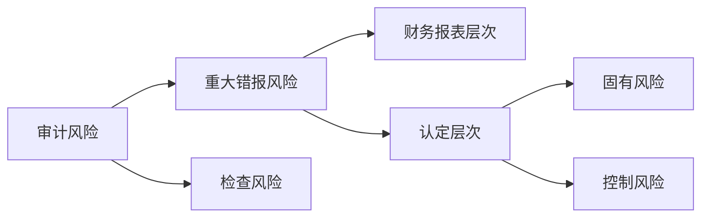
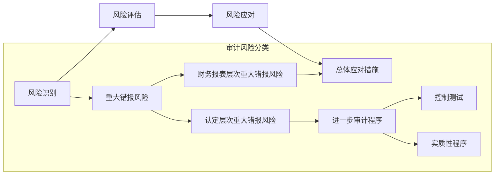

# 审计概述

## 审计的概念与保证程度

### 财务报表审计的概念

- 审计的基础：注册会计师的独立性和专业性

## 审计要素

### 审计业务要素概述

- 预期使用者
- 财务报告编制基础
- 财务报表
- 审计证据
- 审计报告

### 审计业务的三方关系人

- 财务报表预期使用者
- 被审计单位管理层
- 注册会计师

#### 被审计单位管理层

管理层和治理层应对编制财务报表承担完全责任

### 财务报表

审计对象是历史的财务状况、经营成果和现金流量，审计对象信息（即审计对象的载体）是财务报表

### 审计证据

审计证据在性质上具有累积性

## 审计目标

### 认定

#### 关于所审计期间各类交易、事项及相关披露的认定

- 发生
- 完整性
- 准确定
- 截止
- 分类
- 列报

#### 关于期末账户余额及相关披露的认定

- 存在
- 完整性
- 准确性、计价和分摊
- 权利和义务
- 分类
- 列报

## 审计的基本要求

- 维护公共利益
- 遵守审计准则
- 遵守职业道德守则
- 保持职业怀疑
- 运用职业判断

### 保持职业怀疑

保持独立性可以增强注册会计师在审计中保持职业怀疑的能力

### 运用职业判断

#### 职业判断的特征

注册会计师是职业判断的主体，职业判断能力是注册会计师胜任能力的核心

#### 职业判断的衡量标准

- 准确性/意见一致性
- 稳定性/决策一贯性
- 可辩护性

## 审计风险

### 重大错报风险

#### 重大错报风险的分类

由于控制的固有局限性，某种程度的控制风险始终存在

### 检查风险

检查风险取决于审计程序设计的合理性和实施的有效性

### 审计的固有限制

- 财务报表的性质
- 审计程序的性质
- 在合理的时间内以合理的成本完成审计的需要(财务报告的及时性和成本效益的权衡)

由于审计的固有限制，即使按照审计准则的规定适当地计划和执行审计工作，也不可 避免地存在财务报表的某些重大错报可能未被发现的风险

## 审计过程

### 风险导向审计总体思路

## 注册会计师审计的执业责任

### 执业责任

#### 核心标准

判断勤勉尽责的核心标准是会计师事务所和注册会计师是否遵守了法律法规和职业准则