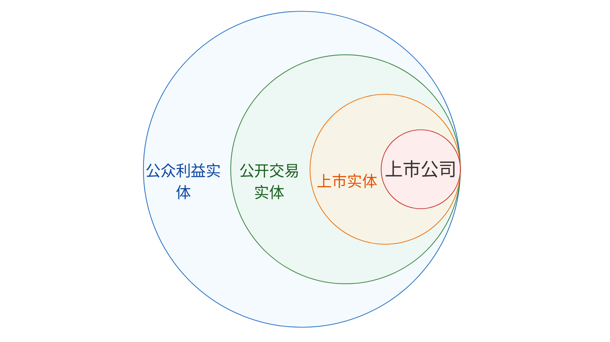
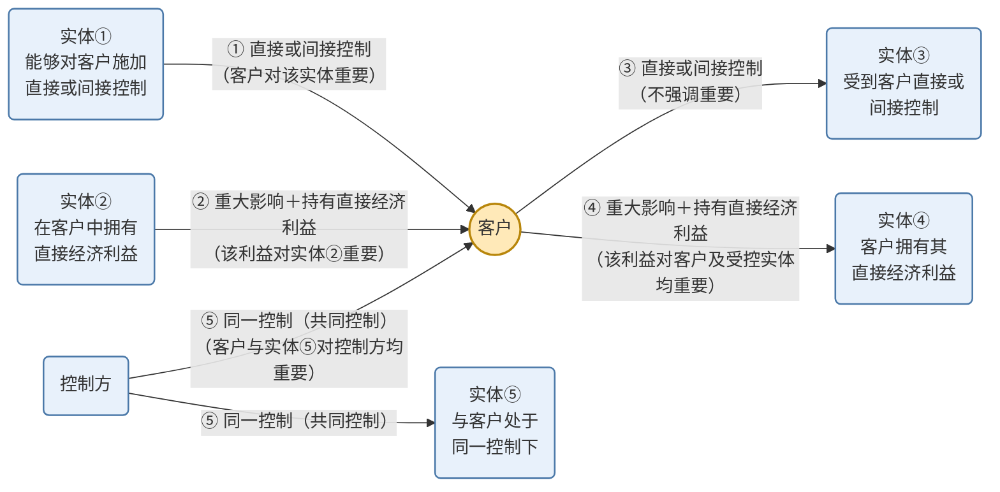

# 审计业务的独立性要求

## 独立性

### 对独立性产生不利影响的因素

- 自身利益
- 自我评价
- 推介或代理
- 密切关系
- 外在压力

### 公众利益实体

### 关联实体

- 能够对客户施加直接或间接控制的实体，并且客户对该实体重要
- 在客户中拥有直接经济利益的实体，并且该实体对客户具有重大影响，在客户中拥有的直接经济利益对该实体重要
- 受到客户直接或间接控制的实体（不强调重要）
- 客户（或受到客户直接或间接控制的实体）拥有其直接经济利益的实体，并且客户能够对该实体施加重大影响，在实体中拥有的直接经济利益对客户和受到客户直接或间接控制的实体均重要
- 与客户处于同一控制下的实体，并且客户和该实体对于其控制方均重要

1. 如果审计客户是公开交易实体，则本章所称审计客户包括该客户的所有关联实体
2. 如果审计客户不是公开交易实体，则本章所称审计客户仅包括该客户直接或间接控制的关联实体

### 保持独立性的期间

1.承接审计业务之日以签订业务约定书或审计项目组开始执行审计业务二者时间孰早为准
2.业务结束日以其中一方通知解除业务关系或出具最终审计报告二者时间孰晚为准

### 管理层职责

会计师事务所及其相关人员不得承担审计客户的管理层职责

## 收费

### 审计收费水平

会计师事务所不得因向审计客户提供审计以外的服务而影响审计收费

### 或有收费

会计师事务所不得（★★）以或有收费方式提供审计服务，包括直接和间接的或有收费

如果一项收费是由法院或政府有关部门规定的，则该项收费不被视为或有收费

如果应从审计客户收取的相当部分的费用长期逾期或者逾期费用较高时，会计师事务所应当确定：逾期收费是否可能被视同向客户提供贷款

### 收费的依赖程度

#### 非公众利益实体审计客户

如果会计师事务所连续五年从某一非公众利益实体审计客户收取的全部费用，占其收费总额的比例超过或可能超过30%，会计师事务所应当采取下列防范措施之一：
1. 在对第五年度财务报表发表审计意见之前，由其他会计师事务所独立复核第五年度的审计工作
2. 在对第五年度财务报表发表审计意见之后、对第六年度财务报表发表审计意见之前，由其他会计师事务所独立复核第五年度的审计工作

#### 公众利益实体审计客户

如果会计师事务所连续两年从某一公众利益实体审计客户收取的全部费用，占其收费总额的比例超过或可能超过15%，该会计师事务所应当确定在对第二年度财务报表发表审计意见之前，由其他会计师事务所实施相当于项目质量复核的复核

如果连续三年持续出现该收费情形，会计师事务所应当在对第三年度财务报表发表审计意见之后，终止对该公众利益实体审计客户的审计业务

## 经济利益

### 基本概念

#### 审计项目团队

审计项目团队包括下列人员: 
1. 审计项目组所有成员
2. 会计师事务所中直接影响审计业务结果的其他人员
    1. 能够影响审计项目合伙人的薪酬和业绩评价的人员，以及提供直接指导、管理或监督的人员，包括从审计项目合伙人的直接上级至会计师事务所管理合伙人（或同等职位）之间的各层级人员
    2. 针对审计业务中的技术问题或行业特定问题、交易或事项提供咨询的人员（如针对与审计相关的准备计提或价值评估工作进行复核的财务交易咨询部的专业人员）
    3. 对审计业务实施质量管理的人员，包括项目质量复核人员
3. 网络事务所中直接影响审计业务结果的所有人员
    1. 能够影响审计项目合伙人的薪酬和业绩评价的人员，以及提供直接指导、管理或监督的人员，包括从审计项目合伙人的直接上级至会计师事务所管理合伙人（或同等职位）之间的各层级人员
    2. 针对审计业务中的技术问题或行业特定问题、交易或事项提供咨询的人员（如针对与审计相关的准备计提或价值评估工作进行复核的财务交易咨询部的专业人员）
    3. 对审计业务实施质量管理的人员，包括项目质量复核人员

审计项目组包括
    1. 会计师事务所执行某项审计业务的合伙人和员工
    2. 为该业务实施审计程序的其他人员（如：内部专家）

审计项目组不包括项目质量复核人员

#### 近亲属
1. 主要近亲属包括配偶、父母和子女
2. 其他近亲属包括兄弟姐妹、祖父母、外祖父母、孙子女、外孙子女

### 由于经济利益对独立性产生不利影响且没有防范措施的情形

#### 在审计客户中拥有经济利益

##### 基本规定

下列各方不得在审计客户中拥有直接经济利益或重大间接经济利益：
1. 会计师事务所及其合伙人
2. 审计项目团队成员及其主要近亲属
3. 与执行审计业务的项目合伙人同处一个分部的其他合伙人的主要近亲属
4. 为审计客户提供非审计服务的其他合伙人和管理人员，以及这些人员的主要近亲属

会计师事务所所有合伙人其本人均不得在审计客户中拥有直接经济利益或重大间接经济利益，而无论该合伙人是否与项目合伙人处于同一分部

##### 例外情况

两类人员：
1. 与执行审计业务的项目合伙人同处一个分部的其他合伙人的主要近亲属（两类人员，仅指主要近亲属）
2. 为审计客户提供非审计服务的其他合伙人和管理人员的主要近亲属

特殊规定：
如果同时满足下列条件，则上述两类主要近亲属可以在审计客户中拥有直接经济利益或重大间接经济利益：
1. 该主要近亲属作为审计客户的员工有权（如通过退休金或股票期权计划）取得该经济利益，并且会计师事务所在必要时能够应对因该经济利益产生的不利影响
2. 该主要近亲属拥有处置该经济利益的权利或者有权行使股票期权时，能够尽快处置或放弃该经济利益

#### 在控制审计客户的实体中拥有经济利益

会计师事务所、审计项目团队成员或其主要近亲属，不得在对审计客户拥有控制性权益的实体中拥有直接经济利益或重大间接经济利益。 前提：审计客户对该实体是重要的

## 贷款和担保以及商业关系、家庭和私人关系

### 贷款和担保

从银行或类似金融机构等审计客户取得贷款，或由此类审计客户提供贷款担保

1. 如果审计客户不按照正常的程序、条款和条件提供贷款或贷款担保
    - 没有防范措施能够将不利影响降低至可接受的水平（自身利益）

2. 会计师事务所按照正常的程序、条款和条件取得贷款（如果该贷款对审计客户或取得贷款的会计师事务所是重要的）
    - 可能因自身利益对独立性产生不利影响

3. 审计项目团队成员或其主要近亲属按照正常的程序、条款和条件取得贷款或获得担保
    - 不会对独立性产生不利影响

4. 从不属于银行或类似金融机构等审计客户取得贷款或由其提供担保
    - 没有防范措施能够将不利影响降低至可接受的水平（自身利益）

5. 在银行或类似金融机构的审计客户开立存款或经纪账户
    - 账户是按照正常的商业条件开立的：不会对独立性产生不利影响
    - 不是按正常的商业条件：不得开立

### 商业关系

#### 一般规定

包含：与客户或其控股股东、董事、监事、高级管理人员或其他为该客户执行高级管理活动的人员共同开办企业

#### 在股东人数有限的实体中拥有经济利益

- 会计师事务所、审计项目团队成员或其主要近亲属与审计客户或其董事、监事、高级管理人员或上述各方作为投资者的任何组合，在某股东人数有限的实体中拥有经济利益，在同时满足下列条件的情况下，不会对独立性产生不利影响：（否则，不得拥有会涉及该实体经济利益的商业关系） 
    1. 这种商业关系对于会计师事务所、审计项目团队成员或其主要近亲属以及审计客户均不重要
    2. 该经济利益对上述投资者或投资者组合并不重大
    3. 该经济利益不能使上述投资者或投资者组合控制该实体

#### 从审计客户购买商品或服务

- 会计师事务所、审计项目团队成员或其主要近亲属从审计客户购买商品或服务，如果按照正常的商业程序公平交易，通常不会对独立性产生不利影响

### 家庭和私人关系

- 如果审计项目团队成员的主要近亲属是审计客户的董事、监事、高级管理人员，或能够对会计师事务所将发表意见的财务报表或会计记录的编制施加重大影响的员工（以下简称特定员工），或者在审计业务期间或财务报表涵盖的期间曾担任上述职务：
    - 没有防范措施能够消除不利影响或将其降低至可接受的水平，拥有此类关系的人员不得成为审计项目团队成员（★★关系至亲且地位极高）

## 与审计客户之间的人员交流

两种情形：审计客户的员工与会计师事务所的员工相互跳槽

### 一般规定

- 会计师事务所前任合伙人或审计项目团队前任成员加入审计客户，担任董事、监事、高级管理人员或特定员工（董、监、高、特）且与会计师事务所保持关联（密切关系或外在压力）除非同时满足下列条件，否则将产生非常严重的不利影响，导致没有防范措施能够消除不利影响或将其降低至可接受的水平：
    1. 该人员无权从会计师事务所获取报酬或福利，除非报酬或福利是按照预先确定的固定金额支付的
    2. 应付该人员的金额对会计师事务所不重要
    3. 该人员未继续参与，并且在外界看来未参与会计师事务所的经营活动或职业活动

### 属于公众利益实体的审计客户

#### 相关概念

关键审计合伙人：
    - 审计项目组中负责对财务报表审计所涉及的重大事项作出关键决策或判断的合伙人，包括项目合伙人、项目质量复核人员、其他关键审计合伙人
    - 关键审计合伙人通常不包括质量管理主管合伙人

#### 具体情形

1. 关键审计合伙人加入属于公众利益实体的审计客户担任重要职位（董、监、高、特）（自身利益、密切关系或外在压力）除非同时满足下列条件，为公众利益实体审计客户执行审计业务的关键审计合伙人不得加入该审计客户担任董事、监事、高级管理人员或特定员工
    1. 该合伙人不再担任该公众利益实体审计业务的关键审计合伙人后，该公众利益实体发布了涵盖期间不少于十二个月的已审计财务报表
    2. 该合伙人未参与该财务报表的审计

2. 会计师事务所前任管理合伙人（或同等职位）加入属于公众利益实体的审计客户担任重要职位（董、监、高、特）（密切关系或外在压力）
    - 该管理合伙人（或同等职位）不再担任该职位已超过十二个月

3. 如果由于企业合并，导致出现会计师事务所前任关键审计合伙人或前任管理合伙人担任属于公众利益实体审计客户的重要职位（董、监、高、特）在同时满足下列条件时，不视为独立性受到损害：
    1. 该人员接受该职务时，并未预料到会发生企业合并
    2. 该人员在会计师事务所中应得的报酬或福利都已全额支付，除非该报酬或福利是按照预先确定的固定金额支付的，并且应付该人员的金额对会计师事务所不重要
    3. 该人员未继续参与，或在外界看来未参与会计师事务所的经营活动或职业活动
    4. 已就该人员在审计客户中的职位与治理层沟通

### 临时借出员工

1. 仅在短期内向客户借出员工
2. 借出的员工不承担审计客户的管理层职责

- 如果因向审计客户借出员工而使会计师事务所与审计客户管理层的观点和利益紧密捆绑，通常没有防范措施能够消除不利影响或将其降低至可接受的水平

### 审计项目团队成员最近曾担任审计客户的董事、监事、高级管理人员或特定员工

1. 在审计报告涵盖的期间曾担任“董、监、高、特”
    - 没有防范措施能够将不利影响降低至可接受的水平

2. 在审计报告涵盖的期间之前曾担任“董、监、高、特”（自身利益、自我评价或密切关系）
    - 由适当复核人员复核该成员已执行的工作

### 兼任审计客户的董事、监事或高级管理人员

如果会计师事务所的合伙人或员工兼任审计客户的董事、监事或高级管理人员，将因自我评价和自身利益产生非常严重的不利影响，导致没有防范措施能够将其降低至可接受的水平

## 与审计客户长期存在业务关系

### 属于公众利益实体的审计客户

#### 一般规定

如果会计师事务所为某一公众利益实体审计客户连续执行审计业务的时间达到十年或以上，会计师事务所应当评价对独立性产生的不利影响，并在事务所层面采取防范措施。如果无法消除不利影响或将其降低至可接受的水平，不得继续为该公众利益实体审计客户执行审计业务

#### 与公众利益实体审计客户关键审计合伙人轮换相关的任职期规定

##### 基本原则

1. 如果审计客户属于公众利益实体，会计师事务所任何人员担任下列职务的累计时间不得超过五年：
    1. 项目合伙人（包括其他签字注册会计师）
    2. 项目质量复核人员
    3. 其他关键审计合伙人

2. 如果某人员继担任项目合伙人之后，该人员在两年内不得担任该审计业务的项目质量复核人员

### 审计客户成为公众利益实体后的轮换时间的确定

1. 如果在审计客户成为公众利益实体之前，该合伙人作为关键审计合伙人已为该客户服务的时间不超过三年，则该人员还可以为该客户继续提供服务的年限为五年减去已经服务的年限。

2. 如果在审计客户成为公众利益实体之前，该合伙人作为关键审计合伙人已为该客户服务的时间超过三年，在取得客户治理层同意的前提下，该合伙人最多还可以继续服务二年。

3. 如果审计客户是首次公开发行股票或者向不特定对象公开发行股票并上市的公司，关键审计合伙人在该公司发行股票或上市后连续执行审计业务的期限，不得超过两个完整会计年度。

### 与公众利益实体审计客户关键审计合伙人轮换相关的冷却期规定

#### 一般情况（★★单一职务）

任职期结束后，该人员应当遵守下列冷却期的规定：、
    1. 如果某人员担任项目合伙人（包括其他签字注册会计师）累计达到五年，冷却期应当为连续五年
    2. 如果某人员担任项目质量复核人员累计达到五年，冷却期应当为连续三年
    3. 如果某人员担任其他关键审计合伙人累计达到五年，冷却期应当为连续二年

#### 特殊情况（★★多项职务）

如果某人员相继担任多项关键审计合伙人职责累计达到五年，冷却期应当按照下列规定计算：
    1. 担任项目合伙人累计达到三年或以上，冷却期应当为连续五年
    2. 担任项目质量复核人员累计达到三年或以上，冷却期应当为连续三年
    3. 担任项目合伙人和项目质量复核人员累计达到三年或以上，但累计担任项目合伙人未达到三年，冷却期应当为连续三年
    4. 担任多项关键审计合伙人职责，并且不符合上述各项情况，冷却期应当为连续二年

## 为审计客户提供非鉴证服务

### 一般规定

#### 评价对独立性产生的不利影响

如果提供非鉴证服务可能因自我评价对财务报表审计产生不利影响，则会计师事务所不得向公众利益实体审计客户提供该非鉴证服务

### 与公众利益实体审计客户治理层沟通非鉴证服务

#### 相关说明

公众利益实体的治理层不同意会计师事务所关于独立性结论：会计师事务所应当拒绝提供非鉴证服务或者终止审计业务

### 会计和记账服务

1. 会计师事务所不得向非公众利益实体审计客户提供会计和记账服务
2. 会计师事务所不得向公众利益实体审计客户提供会计和记账服务

### 评估服务

如果评估结果具有高度的主观性，并且评估服务对会计师事务所将发表意见的财务报表具有重大影响，会计师事务所不得向审计客户提供评估服务

### 税务服务

#### 提供税务服务的一般规定

如果会计师事务所向审计客户提供的税务服务，且该税务处理或交易的重要目的是为审计客户减少、免除、推迟缴纳税款，除非会计师事务所确信该税务处理具备有说服力的税收法律法规依据，否则会计师事务所不得提供该税务服务或推荐该交易

#### 计算当期所得税或递延所得税负债（或资产）的服务

会计师事务所不得向公众利益实体审计客户提供计算当期所得税或递延所得税负债（或资产）的服务

#### 协助解决税务纠纷的服务

如果会计师事务所向公众利益实体审计客户提供涉及协助解决税务纠纷的税务服务，且该服务涉及在仲裁、调解、裁决等非诉纠纷解决机制和诉讼中担任代理人或辩护人，会计师事务所不得提供该服务

### 内部审计服务

#### 对独立性产生不利影响的情形

如果会计师事务所人员在为审计客户提供内部审计服务时承担管理层职责，将产生非常严重的不利影响，导致没有防范措施能够将其降低至可接受的水平

### 信息技术系统服务

对于向公众利益实体审计客户提供的信息技术系统服务，如果可能因自我评价对独立性产生不利影响，会计师事务所不得提供该服务

### 诉讼支持服务

针对公众利益实体审计客户，除非满足就客户所涉事项担任专家证人是仲裁机构或人民法院、人民检察院指定的，否则会计师事务所及其相关人员不得在涉及该公众利益实体审计客户的仲裁或诉讼中担任专家证人

### 法律服务

1. 会计师事务所的合伙人或员工不得担任审计客户的法律顾问

2. 如果所涉金额对会计师事务所将发表意见的财务报表具有重大影响，会计师事务所及其相关人员不得为非公众利益实体审计客户在仲裁、调解、裁决等非诉纠纷解决机制和诉讼中担任代理人或辩护人

3. 会计师事务所及其相关人员不得为公众利益实体审计客户在仲裁、调解、裁决等非诉纠纷解决机制和诉讼中担任代理人或辩护人

### 招聘服务

在向审计客户提供招聘服务时，会计师事务所不得代表客户与应聘者进行谈判

### 公司财务服务

会计师事务所不得提供涉及推荐或承销审计客户股票、债券或其他金融工具的公司财务服务，也不得对此类股票、债券或其他金融工具提供投资建议

## 影响独立性的其他事项

### 薪酬和业绩评价政策

关键审计合伙人的薪酬或业绩评价不得与其向审计客户推销的非鉴证服务直接挂钩。这一规定并不禁止会计师事务所合伙人之间正常的利润分享安排

### 礼品和款待

1. 如果会计师事务所或审计项目团队成员接受审计客户的礼品，将产生非常严重的不利影响，导致没有防范措施能够将其降低至可接受的水平

2. 如果款待超出业务活动中的正常往来，会计师事务所、审计项目团队成员应当拒绝接受。注册会计师应当考虑款待是否具有不当影响注册会计师行为的意图

### 诉讼或诉讼威胁

## 违反独立性要求时会计师事务所应当采取的措施

### 基本要求

按照会计师事务所的政策和程序，立即就该违规行为与下列人员沟通：
    1. 项目合伙人
    2. 负责独立性相关政策和程序的人员
    3. 会计师事务所和网络中的其他相关人员
    4. 需要采取适当行动的人员

### 与治理层的沟通